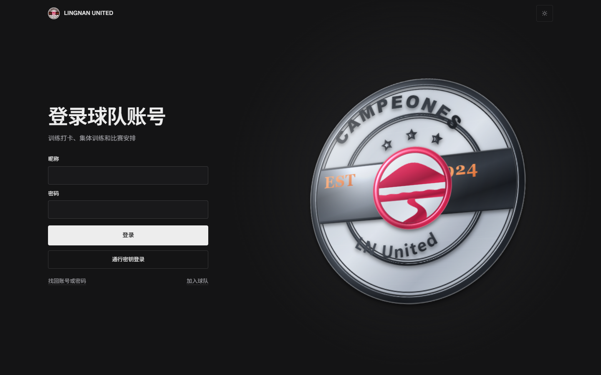

# LINGNAN UNITED

一个供球队使用的训练打卡网站。队员可以查看任务、提交训练记录和查看积分；管理员可以发布任务、审核记录并管理成员。

## 页面预览

登录页面：



账号找回页面：


截图来自正式站的公开页面。

## 功能

- **训练记录**：首页用七天数轴展示本周打卡，支持在抽屉中提交训练记录。重新打开同一任务会保留草稿，切换任务会清空旧内容和截图。
- **球队与积分**：球队页展示累计训练积分排名，积分商城展示可用积分和兑换入口。
- **管理**：发布任务、审核训练记录、管理成员和奖励。
- **账号**：使用密码或通行密钥登录。网站只签发会话 Cookie，从地址栏、书签或外部链接重新进入时，支持导航标头的浏览器会要求重新登录。注册使用邀请码和邮箱验证码，找回账号需要真实姓名和已验证邮箱。
- **集体训练与计划**：训练安排、出勤和每周计划集中在 `/training-sessions`。队长或管理员可以安排训练、确认出勤和编辑计划，每周计划支持手动战术板。启用计划功能时，旧的 `/plans` 入口也打开这个页面。数据库与规则见 [集体训练请假与出勤方案](docs/集体训练请假与出勤方案.md)。
- **我的请假**：从账号设置页顶部进入 `/leave`，分别提交、修改、取消训练和比赛请假并查看记录。两类均沿用提前 72 小时的规则，比赛出勤由队长或管理员确认。数据库与部署记录见 [账号页训练与比赛请假变更方案](docs/账号页训练与比赛请假变更方案.md)。
- **球队动态与头像**：队员可查看训练动态并设置头像。
- **赛程提醒**：训练首页显示下一场比赛，完整赛程在比赛中心查看，由比赛维护人员更新。
- **比赛中心**：集中查看和管理各类比赛、比分和战报；赛后反思按比赛归档，支持点赞和评论。数据结构和维护记录见 [比赛中心数据与上线方案](docs/比赛中心数据与上线方案.md)。
- **积分开箱**：每次消耗 1 积分，可选择心仪奖品；奖品、库存、积分奖励和保底规则以页面及当前实现为准。
- **网站更新公告**：首页展示未确认的更新公告，确认状态按账号保存。当前为 2026 年 11 月 26 日发布的第 7 版。维护方法见 [网站更新公告](docs/网站更新公告.md)。

训练助手入口和战术板 AI 操作当前已停用。

## 本地运行

需要 Python 3 和 `requirements.txt` 中的依赖。以下示例使用 PowerShell：

```powershell
python -m venv .venv
.\.venv\Scripts\Activate.ps1
python -m pip install -r requirements.txt
python app.py init-admin --name 管理员昵称
python app.py serve
```

创建管理员时按提示输入密码。启动后访问 <http://127.0.0.1:5050/>。开发服务器仅供本地使用。本地测试通行密钥时请使用 `http://localhost:5050/`，与默认的通行密钥验证地址保持一致。

邮件验证需要配置 `TEAM_SMTP_USER`、`TEAM_SMTP_PASSWORD` 和 `TEAM_SMTP_FROM`。生产环境还需要设置足够长且随机的 `TEAM_SECRET`，配置示例见 [deploy/environment-example.env](deploy/environment-example.env)。真实密码、授权码和 API Key 应保存在环境变量或受保护的配置文件中。通行密钥在生产环境中需要 HTTPS，并通过 `TEAM_PUBLIC_URL` 配置用户实际访问的网站地址；更换域名后，原域名下的通行密钥不能直接用于新域名。

## 数据与测试

SQLite 数据库、训练截图、球队问答语料和服务器连接资料未提交到仓库。缺少问答语料时，相关检索功能及依赖语料的测试不可用。

```powershell
@('test_app', 'test_lottery', 'test_training_ranking', 'test_passkeys', 'test_avatars', 'test_moments', 'test_match_center') | ForEach-Object { python -m unittest $_ }
```

各测试模块分别启动进程，避免它们共享临时数据库。

## 生产维护

生产站点位于 `https://lingnanunited.site/football/`。应用数据与代码分开保存，数据库、用户上传文件、私有语料和真实环境配置不应提交到仓库。线上使用 systemd 定时备份，配置和脚本见 `deploy/football-auto-backup.*` 与 `deploy/football_auto_backup.py`；默认每两小时备份并保留七天，备份存放在服务器本机。2026-11-21 核对时定时器为启用和运行状态；这不代表已完成异地备份或恢复演练。

服务器运行目录不是 Git 工作区。同步前应比较线上实际文件、本地和远端仓库，保留本地未提交改动，并排除数据库、上传文件及密钥。

2026 年 11 月 26 日上线了 3D 队徽、训练首页和集体训练合页，随后更新了移动端渲染和会话登录规则。见 [上线记录](docs/前端优化与请假页调整.md#2026-11-26-3d-队徽训练页面与会话登录)。

## 技术栈

Python、Flask、SQLite，以及 HTML、CSS 和 JavaScript。
