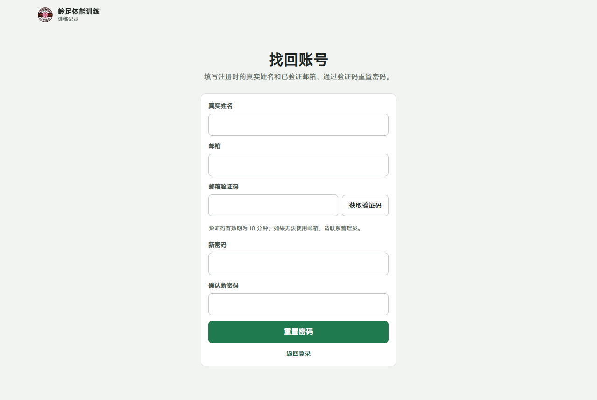

# 岭足体能训练

一个供球队使用的训练打卡网站。队员可以查看任务、提交训练记录和查看积分；管理员可以发布任务、审核记录并管理成员。

## 页面预览

登录页面：


账号找回页面：



截图来自本地演示环境，未使用真实队员数据。

## 功能

- **训练记录**：查看每周任务，提交训练时长、感受和截图，回顾历史记录。
- **球队与积分**：查看球队排名和积分，并使用积分兑换奖励。
- **管理**：发布任务、审核训练记录、管理成员和奖励。
- **账号**：使用邀请码和邮箱验证码注册；通过真实姓名及已验证邮箱找回账号并重置密码。
- **训练助手**：提供球队问答和 AI 辅助功能；AI 功能需要另行配置服务。

## 本地运行

需要 Python 3 和 `requirements.txt` 中的依赖。以下示例使用 PowerShell：

```powershell
python -m venv .venv
.\.venv\Scripts\Activate.ps1
python -m pip install -r requirements.txt
python app.py init-admin --name 管理员昵称
python app.py serve
```

创建管理员时按提示输入密码。启动后访问 <http://127.0.0.1:5050/>。开发服务器仅供本地使用。

邮件验证需要配置 `TEAM_SMTP_USER`、`TEAM_SMTP_PASSWORD` 和 `TEAM_SMTP_FROM`。生产环境还需要设置足够长且随机的 `TEAM_SECRET`，配置示例见 [deploy/environment-example.env](deploy/environment-example.env)。真实密码、授权码和 API Key 应保存在环境变量或受保护的配置文件中。

## 数据与测试

SQLite 数据库、训练截图、球队问答语料和服务器连接资料未提交到仓库。缺少问答语料时，相关检索功能及依赖语料的测试不可用。

```powershell
python -m unittest test_app
```

## 技术栈

Python、Flask、SQLite，以及 HTML、CSS 和 JavaScript。
